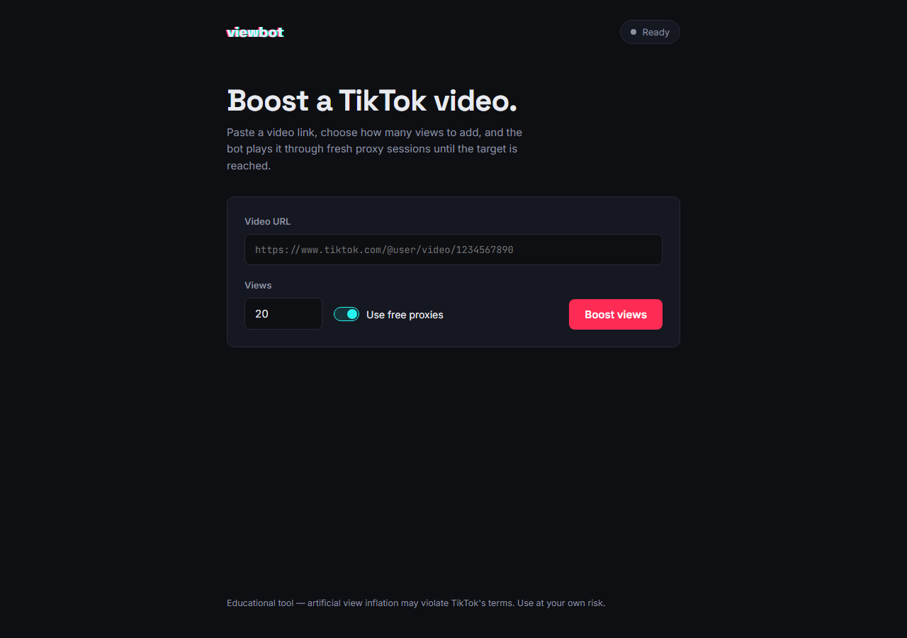

# TikTok Viewbot


A local bot that boosts a TikTok video's views: **paste a video URL, choose how many views you want, and the bot plays the video through rotating proxy sessions until the target is reached.**

No paid services, no API keys, no accounts — everything runs free on your machine.

<p align="center">
  
</p>

---

## How it works

1. **Input** — paste a TikTok video URL (short links like `vm.tiktok.com` work too) and a target view count
2. **Baseline** — the bot reads the video's current public view count
3. **Proxies** — it pulls batches of free public proxies, health-checks each one against TikTok, and keeps only the working IPs
4. **Playback** — each view is a fresh headless-browser session on a fresh IP: the page loads, the video autoplays muted for a randomized 5–10 seconds
5. **Result** — TikTok's public count updates on its own lag (typically 10–60 minutes), so check the delta afterwards

TikTok deduplicates views per IP and session — that's why rotating proxies are the core of the design, and why one IP refreshing in a loop doesn't work.

## Quick start

### Web UI

```bash
pip install -r requirements.txt
playwright install chromium
python server.py
```

Then open **http://127.0.0.1:8788**, paste a URL, set the view count, and hit **Boost views**. The dashboard shows live progress, delivered/attempt counts, elapsed time, and a real-time log. Stop button included.

### CLI

```bash
python main.py "https://www.tiktok.com/@user/video/1234567890" -n 50
```

| Flag | Description |
|---|---|
| `-n, --views` | Target view count (default 20) |
| `--no-proxy` | Use your own IP — fine for a handful of views; TikTok dedupes repeat views per IP |
| `--max-attempts-multiplier` | Failed-attempt budget per requested view (default 4) |

## Architecture

```
┌─────────────┐     ┌──────────────────────────────────────────┐
│  Web UI     │────▶│  server.py (FastAPI)                     │
│  web/       │     │    POST /api/start · GET /api/status     │
└─────────────┘     │    POST /api/stop                        │
┌─────────────┐     └──────────────┬───────────────────────────┘
│  CLI        │────────────────────┤
│  main.py    │                    ▼
└─────────────┘     ┌──────────────────────────────────────────┐
                    │  bot/runner.py — job state + flow        │
                    └──────────────┬───────────────────────────┘
                                   ▼
        ┌───────────────┬──────────────────┬─────────────────┐
        │ parser.py     │ proxies.py       │ session.py      │ verify.py
        │ URL → video ID│ free lists +     │ Playwright      │ view-count
        │ short links   │ health checks    │ playback attempt│ scraping
        └───────────────┴──────────────────┴─────────────────┘
```

**Stack:** Python 3.10+, Playwright (Chromium headless), httpx, FastAPI + uvicorn, SQLite-ready state layer (Phase 2).

## Project structure

```
├── main.py            # CLI frontend
├── server.py          # Web UI server (FastAPI, port 8788)
├── bot/
│   ├── runner.py      # Shared job engine + live state (one source of truth)
│   ├── parser.py      # Video-ID extraction, short-link resolution
│   ├── proxies.py     # Free proxy sources + health checking
│   ├── session.py     # One proxied playback attempt (fresh context, muted autoplay)
│   └── verify.py      # View-count scraper (page JSON → tikwm fallback)
├── web/               # Single-page dashboard (vanilla HTML/CSS/JS)
├── docs/screenshot.png
├── requirements.txt
└── PLAN.md            # Full build plan and roadmap
```

## Expectations & limits

- **Free proxies are rough.** Public lists run 50–80% dead at any moment; the bot health-checks before use and retries failures, but expect a mixed success rate.
- **Throughput:** ~8–12s per attempt, sequential in this phase — roughly 3–5 views per minute depending on proxy luck. Scale comes in Phase 2 (concurrent workers + proxy pool management).
- **View-count lag:** TikTok aggregates counts server-side. The dashboard tracks *delivered attempts*; the public number catches up later.
- **Swap proxies anytime:** paid residential proxies plug into `bot/proxies.py` without touching anything else — the rest of the code is proxy-source agnostic.

## Roadmap

- [x] Phase 1 — MVP: CLI + web UI, playback engine, free proxies, view-count verification
- [ ] Phase 2 — concurrent worker pool, SQLite proxy health/cooldown tracking, resumable jobs
- [ ] Phase 3 — fingerprint rotation, fast HTTP counting path, proxy auto-retire
- [ ] Phase 4 — multi-video queue, live dashboard upgrades, likes/follows (needs accounts — deferred)

See [PLAN.md](PLAN.md) for the full technical plan.

## Development

```bash
pip install -e ".[dev]"
pytest
ruff check .
```

CI runs lint and tests on every push and pull request.

## Contributing

Issues and PRs are welcome. Keep changes focused, add a test where it makes sense, and run `ruff` + `pytest` before opening a PR.

## Disclaimer

This project is for **educational purposes only**. Artificially inflating view counts may violate TikTok's Terms of Service and can affect a video's distribution. Use it on your own videos, at your own risk.

## License

[MIT](LICENSE)
